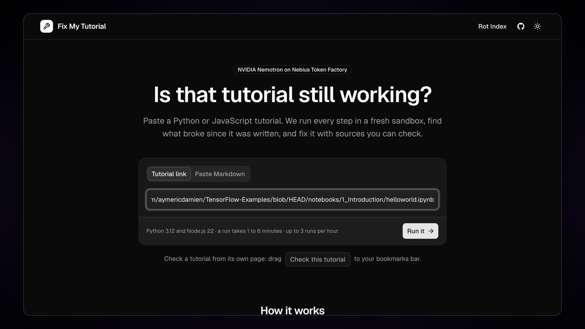
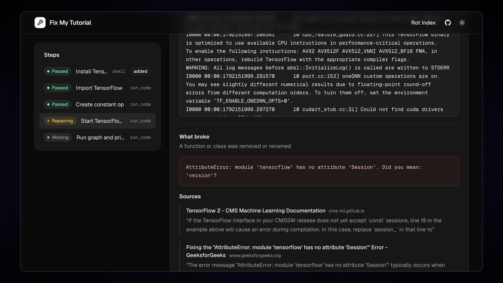
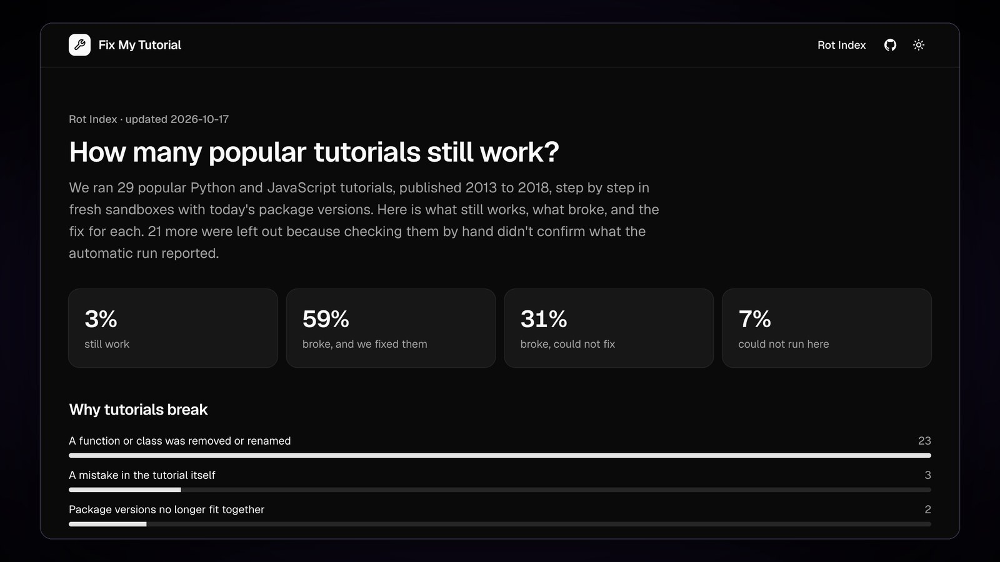

# Fix My Tutorial

Run an old coding tutorial, find what broke, and fix it with sources you can check.

[](https://github.com/iamarunbrahma/fix-my-tutorial/actions/workflows/ci.yml)
[](LICENSE)
[](pyproject.toml)
[](#models)
[](#models)
[](https://devpost.com/software/fix-my-tutorial)

**Live Demo:** [fix-my-tutorial.onrender.com](https://fix-my-tutorial.onrender.com)<br>
**Video Demo:** [youtu.be/SwJhk6Onl38](https://youtu.be/SwJhk6Onl38)


## Why

Coding tutorials rot. A guide written in 2016 breaks today because a library removed a function or renamed a package, and learners hit an error the author never saw. NVIDIA's own OpenShell repo has an open issue titled ["Tutorial Rot"](https://github.com/NVIDIA/OpenShell/issues/2998).

Fix My Tutorial runs the tutorial exactly as written in a fresh sandbox. When a step breaks, it finds the release note or issue that explains why, races several fixes in parallel, and proves the winner with a clean re-run from scratch.

## How it works

1. **Plan.** Nemotron 3 Super turns the page into steps, keeping the code exactly as written.
2. **Run.** Every step runs in a Nebius Token Factory Sandbox, with a checkpoint after each step.
3. **Diagnose.** Nemotron 3.5 Lightning classifies the error, and Tavily finds the source that explains it.
4. **Repair.** Nemotron 3 Ultra proposes up to three fixes that cite their sources. They race in parallel from the last good checkpoint.
5. **Prove.** The winning fix is replayed from scratch before the tutorial is called fixed. The report shows the diff, the sources, the release that broke the step, and a pre-filled GitHub issue for the author.

|  |  |
|:---:|:---:|
| Paste a tutorial link | See what broke, with sources |
|  |  |
| Fixed after a clean replay | Report, badge and a note for the author |

## Models

All models run on Nebius Token Factory through one OpenAI-compatible API with JSON-schema output. The expensive model only runs when something is broken.

| Role | Model | Why this size |
|---|---|---|
| Plan, summary | `nvidia/nemotron-3-super-120b-a12b` | Reads a whole tutorial into a strict JSON plan |
| Triage, release finder | `nvidia/Nemotron-3_5-Lightning` | Fast, cheap error classification |
| Judge | `nvidia/NVIDIA-Nemotron-3-Nano-30B-A3B` | Cheap yes/no on fuzzy expectations |
| Repair | `nvidia/Nemotron-3-Ultra-550b-a55b` | Hard reasoning over the error, the code and the evidence |

Token Factory Sandboxes save an image after each step, so candidate fixes start from the same checkpoint at once. Tavily search and extract turn each failure into short quotes from real pages, cached for 7 days.

## Rot Index

How many old tutorials still work? The [Rot Index](https://fix-my-tutorial.onrender.com/index) shows 29 popular Python and JavaScript tutorials published 2013 to 2018, each run step by step with today's packages. They come from a [list of 115](rot_index/list.yaml) picked before any of them ran. Every result is checked by hand, and a tutorial is left out when that check doesn't confirm what the automatic run reported.



## Results

On 15 fixture tutorials (13 broken by real library changes, 2 that still work), the latest run on 17 Oct 2026 fixed all 13 broken tutorials (12 in the first repair round) and left both working tutorials untouched. A fixed tutorial cost about $0.017 in model calls and took a little over two minutes (median).

## Run it locally

You need Python 3.12, [uv](https://docs.astral.sh/uv/), a Nebius Token Factory key, a Tavily key, and Docker or Token Factory Sandboxes access.

```bash
uv sync
cp .env.example .env                              # NEBIUS_API_KEY, TAVILY_API_KEY, ADMIN_TOKEN, SANDBOX_BACKEND
uv run uvicorn fixmytutorial.web.app:app --reload
```

For Token Factory Sandboxes, set `SANDBOX_BACKEND=contree` and build the base images once. Put the two image IDs it prints into `.env`.

```bash
uv run python -m fixmytutorial.sandbox.prepare
```

<details>
<summary>Using Docker instead</summary>

The Docker sandbox refuses to run until a probe from inside a container shows that private addresses (your LAN, the host, cloud metadata) are unreachable. On a Linux host, create a network that can't reach them:

```bash
docker network create --driver bridge --opt com.docker.network.bridge.name=fmt0 \
  --opt com.docker.network.bridge.enable_icc=false fmt-sandbox
for net in 10.0.0.0/8 172.16.0.0/12 192.168.0.0/16 100.64.0.0/10 169.254.0.0/16; do
  sudo iptables -I DOCKER-USER -i fmt0 -d "$net" -j DROP
done
sudo iptables -I INPUT -i fmt0 -j DROP
```

Then set `SANDBOX_BACKEND=docker` and `DOCKER_NETWORK=fmt-sandbox`. On a laptop, and only for tutorials you trust, `DOCKER_ALLOW_PRIVATE_EGRESS=true` skips the probe.

</details>

```bash
uv run pytest                                     # offline tests, no API calls
uv run python -m fixmytutorial.eval               # live evaluation (uses real credits)
uv run python -m fixmytutorial.rot_index run      # run the Rot Index list, then `export` for the page
```

## Cost controls

- Every model and Tavily call reserves its worst-case cost in a ledger first, and is refused if it would cross a cap.
- The hosted demo has its own $12 lifetime budget and holds $7.50 of it back for judges until 1 December.
- Each run is capped at $0.50 and 30 Tavily credits; public runs at $3 a day and 3 per hour per visitor.
- If the ledger can't be loaded or saved, public runs pause instead of starting from zero.

## Limitations

- CPU only, Python and JavaScript only. Tutorials that need a GPU, a database server, a GUI or a paid API are reported as not runnable.
- Calls to OpenAI-style APIs go to a stand-in server in the sandbox: they prove the SDK calls are right, not what a model would answer.
- A step with no visible output passes if it exits cleanly.
- The release that broke a step is shown only when an older release can be run or a cited release note names it.

## License

MIT. See [LICENSE](LICENSE).
