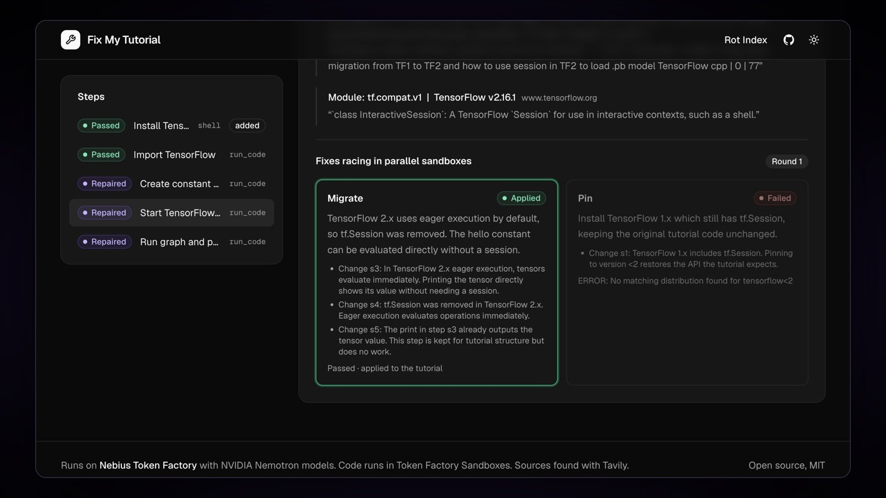
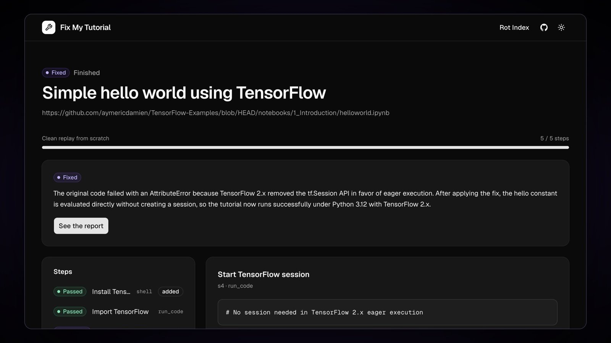
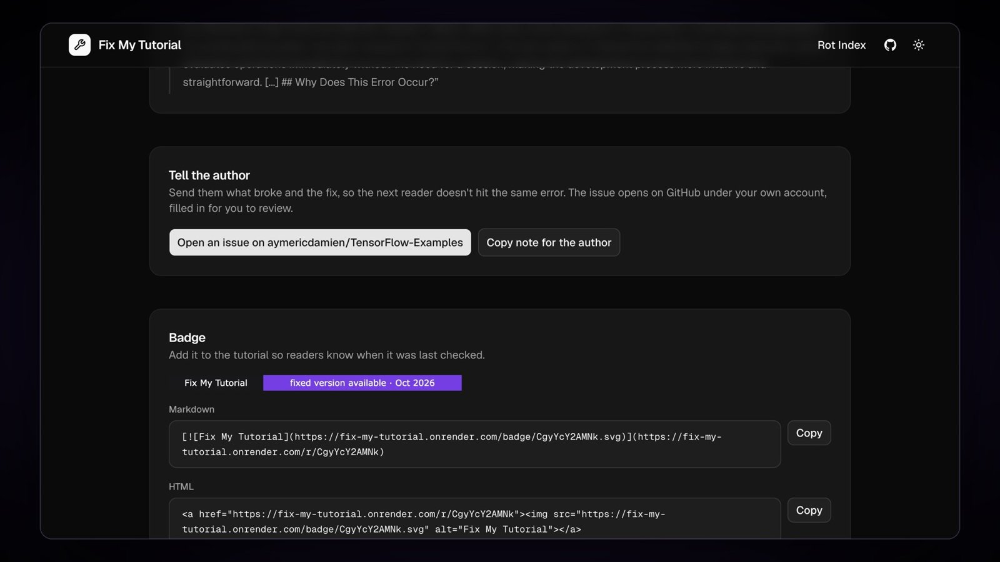

# Fix My Tutorial

Run any coding tutorial, find what broke, and fix it with sources you can check.

[](https://fix-my-tutorial.onrender.com)
[](https://youtu.be/SwJhk6Onl38)
[](https://github.com/iamarunbrahma/fix-my-tutorial/actions/workflows/ci.yml)
[](LICENSE)
[](pyproject.toml)
[](#how-we-use-nvidia-nemotron)
[](#where-nebius-token-factory-accelerated-the-work)
[](#tavily)
[](https://nebiusglobalaihackathon.devpost.com/)

**Try it: [fix-my-tutorial.onrender.com](https://fix-my-tutorial.onrender.com)** · **Watch the 2:38 demo: [youtu.be/SwJhk6Onl38](https://youtu.be/SwJhk6Onl38)**. Every step runs in a Nebius Token Factory Sandbox, and the models are NVIDIA Nemotron on Nebius Token Factory.



## Why

Coding tutorials rot. A guide written in 2016 breaks today because a library removed a function, renamed a package or changed a default, and learners hit an error the author never saw. AI assistants trained on those same pages repeat the broken code. NVIDIA's own OpenShell repo has an open issue titled ["Tutorial Rot"](https://github.com/NVIDIA/OpenShell/issues/2998).

Fix My Tutorial runs the tutorial exactly as written in a fresh sandbox, and when a step breaks it finds the changelog or issue that explains why, races several fixes in parallel, and proves the winner with a clean re-run from scratch.

## How it works

```
Browser ──HTTP/SSE──> FastAPI (web)
                         │
                         ├── jobs: in-process queue, max 4 concurrent runs
                         │
                         └── pipeline (per run)
                               ingest ──> planner ──> executor ──┬──> report
                                                    │            │
                                         on failure ▼            │
                                 triage ─> research ─> repair ─> judge
                                                    │
                     sandbox interface ─────────────┘
                       ├── ContreeBackend  (Token Factory Sandboxes, production)
                       └── DockerBackend   (local dev and fallback)

Shared: llm (Token Factory client + routing), ledger (cost controls),
        store (SQLite), events (per-run event bus feeding SSE)
```

1. **Plan.** Nemotron 3 Super reads the page and turns it into ordered steps: shell commands, files to write, code cells, and servers to probe. The code is kept exactly as written, because running the original is how breakage is found.
2. **Run.** Each step runs in an isolated sandbox, with a checkpoint saved after each step. Python cells share one namespace, so notebook-style tutorials keep their variables.
3. **Diagnose.** When a step fails, Nemotron 3.5 Lightning classifies the error (removed API, renamed package, version conflict and so on), and Tavily finds the release note, migration guide or issue that explains it.
4. **Repair.** Nemotron 3 Ultra proposes up to three fixes (migrate to the new API, pin an older version, or work around it). When evidence was found, each fix must cite it. The fixes race in parallel sandboxes from the last good checkpoint.
5. **Prove it.** The repaired tutorial is replayed from scratch before it is called fixed. The report shows the diff, the cited reasons, and a badge.
6. **Date it.** When a package change broke the step, the failing step runs again from its checkpoint with older releases of that package: the one before a cited version, or the end of each earlier release series, then a short binary search. When older releases can't install on today's Python (pandas 1.x and NumPy before 1.26 can't on 3.12), one more Tavily search looks for the release note itself, and Nemotron 3.5 Lightning reads it. Only a version that exists on PyPI or npm and that the quote (or the release note's own address) states is accepted, and the report says which way it was found. When the releases before a cited one can't install, the releases after it are run instead, so a note that dates a deprecation is not mistaken for the release that removed it. In our runs: "Broke in chalk 5.0.0, released 26 Nov 2021. chalk 4.1.2 still runs this step, and 5.0.0 fails the same way." and "Broke in pandas 2.0.0, released 3 Apr 2023, according to the cited release notes." When the page states its publish date, the report also says how long the tutorial worked.



| Role | Model | Price per 1M tokens (in / out) | Why this size |
|---|---|---|---|
| planner | `nvidia/nemotron-3-super-120b-a12b` | $0.30 / $0.90 | Long-context reading of a whole tutorial into a strict JSON plan |
| triage | `nvidia/Nemotron-3_5-Lightning` | $0.06 / $0.24 | Fast, cheap classification of an error log |
| judge | `nvidia/NVIDIA-Nemotron-3-Nano-30B-A3B` | $0.06 / $0.24 | Cheap yes/no on fuzzy expectations ("prints the accuracy") |
| repair | `nvidia/Nemotron-3-Ultra-550b-a55b` | $1.00 / $3.00 | Hard reasoning over the error, the code and the evidence; only runs on failures |
| summary | `nvidia/nemotron-3-super-120b-a12b` | $0.30 / $0.90 | One plain-language paragraph about the run |
| release finder | `nvidia/Nemotron-3_5-Lightning` | $0.06 / $0.24 | Reads the cited release notes for the version that made the change |

After a check, the report offers:

- **Tell the author.** For a tutorial on GitHub, "Open an issue" opens GitHub's new-issue page filled in with what broke, the fix and its sources, for you to review and file from your own account. For any other site, copy the same note.
- **A badge** the author can add to the page.
- **Check from any page.** Drag the "Check this tutorial" bookmark from the home page to your bookmarks bar, or share a link like `/?url=<tutorial>`. The link only fills in the form; a run always starts with a click.




## Rot Index

How many old tutorials still work? The [Rot Index](https://fix-my-tutorial.onrender.com/index) shows 31 popular Python and JavaScript tutorials published 2013 to 2018, each run step by step with today's packages: what still works, what broke, the fix for each, and which releases broke the most tutorials. They come from a [list of 115](rot_index/list.yaml) picked before any of them ran (34 were expected to still work), so the index is not filled with known breakages. Each result is checked by hand before it is published, and a tutorial is left out when that check doesn't confirm what the automatic run reported. A "fix" that only undoes our own misreading of the page, or that relies on data the tutorial doesn't provide, does not count as a fix.

```bash
uv run python -m fixmytutorial.rot_index run --limit 40 --concurrency 3   # in slices, inside the daily budget
uv run python -m fixmytutorial.rot_index export                           # writes rot_index/results.json for the page
```

## How we use NVIDIA Nemotron

Four Nemotron sizes split the work so the expensive model only runs when something is actually broken:

- **Nemotron 3 Super** plans every run (about $0.0013 per plan) and writes the summary (about $0.0004).
- **Nemotron 3.5 Lightning** triages each failure (about $0.0002 per call) and reads the release notes for the version that broke it.
- **Nemotron 3 Nano** judges fuzzy expectations (about $0.00004 per call); exact checks never reach a model.
- **Nemotron 3 Ultra** writes the fixes (about $0.01 per repair round) and is the bulk of the cost.

Every call uses JSON-schema structured output, validated with pydantic.

**Live evaluation:** 15 fixture tutorials, 13 broken by real library changes (pandas `append` and `iteritems`, NumPy `np.float`, scikit-learn `load_boston` and `OneHotEncoder(sparse=)`, openai 0.x, LangChain `langchain.llms`, Flask `before_first_request`, seaborn styles, chalk and node-fetch ESM, Express 5 wildcards, faker) and 2 that still work. On the latest run (17 Oct 2026, in Token Factory Sandboxes), all 13 broken tutorials were fixed (12 in the first repair round) and both working tutorials were left untouched. A fixed tutorial cost about $0.017 in model calls on average and took a little over two minutes (median).

Earlier runs during the build scored 12, 11, 13, 11, 13, 13, 12 and 13 out of 13, and one of them called a working tutorial "fixed". Each miss traced back to a gap we then closed in code: the planner inventing output checks, marking outdated code as "not runnable", dropping the tutorial's code block, mangling code into escaped newlines, or never running a file the tutorial only says to run in prose, and our judge rejecting the stand-in API server's placeholder reply.

## Where Nebius Token Factory accelerated the work

- **One OpenAI-compatible API for four model sizes.** Routing is a lookup from role to model ID; the client, retries and spend accounting are shared.
- **JSON-schema output** made every stage a typed function. The planner, triage, judge and repair stages return validated pydantic objects, not text to parse.
- **Sandboxes (Contree) checkpoints and branches** fit the repair race directly: save an image after each step, then start several candidate fixes from the same image at once.

## Tavily

Research uses Tavily search, then Tavily extract with a focused query on the top results, so each piece of evidence is a short quote from a real page, with its URL. Quotes that never mention the failing symbol are dropped. Results are cached for 7 days, so tutorials that share a root cause (several pandas tutorials hitting `append`, say) reuse the same evidence. A repaired step typically uses 2 to 4 credits. Finding the release that broke it takes about 2 more, and only when running older releases can't settle it. A run is capped at 30.

## Run it locally

Requirements: Python 3.12, [uv](https://docs.astral.sh/uv/), Docker (or Nebius Token Factory Sandboxes access), a Nebius Token Factory key and a Tavily key.

```bash
uv sync
cp .env.example .env        # fill in NEBIUS_API_KEY, TAVILY_API_KEY and ADMIN_TOKEN; set SANDBOX_BACKEND=docker
uv run uvicorn fixmytutorial.web.app:app --reload
```

To run tutorial code in Nebius Token Factory Sandboxes instead of Docker, as the live demo does, set `SANDBOX_BACKEND=contree`, build the two base images once, and put the two image IDs it prints into `.env` (Sandboxes uses the same `NEBIUS_API_KEY`):

```bash
uv run python -m fixmytutorial.sandbox.prepare   # prints CONTREE_PYTHON_IMAGE=... and CONTREE_NODE_IMAGE=...
```

The Docker sandbox refuses to run until a probe from inside a container shows that private addresses (your LAN, the host, cloud metadata) are unreachable. On a Linux host, run it on a network that can't reach them:

```bash
docker network create --driver bridge --opt com.docker.network.bridge.name=fmt0 \
  --opt com.docker.network.bridge.enable_icc=false fmt-sandbox
for net in 10.0.0.0/8 172.16.0.0/12 192.168.0.0/16 100.64.0.0/10 169.254.0.0/16; do
  sudo iptables -I DOCKER-USER -i fmt0 -d "$net" -j DROP   # LAN, carrier-grade NAT, cloud metadata
done
sudo iptables -I INPUT -i fmt0 -j DROP                      # the host itself
```

Then set `SANDBOX_BACKEND=docker` and `DOCKER_NETWORK=fmt-sandbox`. On a laptop, and only for tutorials you trust, set `DOCKER_ALLOW_PRIVATE_EGRESS=true` to skip the probe.

```bash
uv run pytest                       # offline tests with fakes, no API calls
uv run python -m fixmytutorial.eval # live evaluation over the fixture tutorials (uses real credits)
```

## Cost controls

These protect whoever runs the app, not the learner: they keep the API bill inside the credits you have. The hosted demo runs on Token Factory credits with a bank card on file, so it must never spend past them:

- Every model and Tavily call goes through a ledger that reserves an upper-bound cost first, and refuses the call if it would cross a cap.
- The public demo and our own evaluation runs have separate budgets ($15 and $11 lifetime) that, with a margin for runs cut off by a restart, stay under the account's $30.50 of credits. So neither has to trust the other's records.
- Daily and per-run caps: $3 a day, $0.50 per run, 30 Tavily credits per run and 5,000 lifetime.
- Until 1 December, when judging starts, the demo holds $7.50 of its $15 back from public runs, so a busy launch can't leave the demo closed for judges. Past reports and the Rot Index stay open while public runs are paused.
- Calls that fail after they may have been billed are charged at their upper bound.
- If the demo's ledger can't be loaded or saved, public runs pause instead of starting from zero, and the app keeps retrying until it can.
- Public runs are limited to 3 per hour per visitor.

## Limitations

- CPU only. Tutorials that need a GPU, a database server, a GUI or a paid API are reported as "not runnable".
- Python and JavaScript only.
- Code that calls OpenAI-style APIs talks to a stand-in server inside the sandbox. It proves the SDK calls are correct today, not what a real model would answer.
- Fixes are checked by running the tutorial, not by reading it. A step with no visible output passes if it exits cleanly.
- "When it broke" needs an older release that still installs on Python 3.12 or Node.js 22 to be checked by running. Otherwise it rests on the cited release notes, and the report says so. When no source names the exact release, the report leaves it out rather than guess.
- Each step runs as its own sandbox operation, so a server started in one step is not running for the next. Tutorials built around a long-running server get a start-up check only.

## License

MIT. See [LICENSE](LICENSE).
